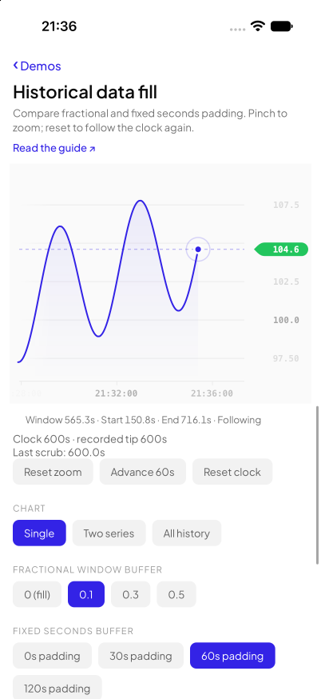
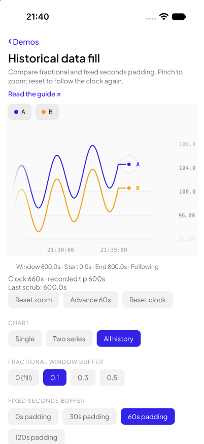

# PR #436 review and native QA

Reviewed on 2026-11-16 against PR head `ab4700c07223498d7d9e1c76dee28af5e72d97a3`
and base `f270db4fad7073a2047faaa1847c93944947e13c`.

**Result:** no merge-blocking library defect found. The follow-up change improves
JSDoc/API guidance and adds reproducible controls to the historical-data demo;
it does not change the library's runtime implementation.

## Review scope

Checked the fixed seconds through both component controllers, engine hooks,
frame inputs, and tick functions; single-series static/auto-sleep subscriptions
and gesture wake boundaries; multi-series history-span calculation; recorded
line/dot/scrub gating; and backward compatibility when seconds are absent or zero.
Reviewed the regression tests and the example app dependency/lockfile changes.

Documentation now explains negative-value clamping, additive padding, fixed time
versus pixel width, minimum zoom considerations, and parked viewport behavior.
The historical-data guide includes a concrete example and its demo supports both
charts, history anchoring, clock advancement, native pinch/reset, and scrub readouts.
Removed `paused` from the frozen-clock example: `nowOverride` already freezes its
clock and permits the engine to apply the configured right-edge padding.

## Automated checks

- `npm ci` and `npx expo install --check`: passed against the PR lockfile.
- `npm run verify`: passed before and after changes — 165 suites, 2,317 tests
  passed, 5 skipped; typecheck and lint passed.
- `npm run build:lib`: passed; emitted declarations include `windowBufferSeconds`.
- `npm run verify:bundle-mode-consumer`: packed consumer iOS export passed.
- `npx react-doctor@latest --verbose --diff`: no issues, score 93 before and after.
- Upstream GitHub Test and CodeQL checks were green at the reviewed head.

The Jest suite emits existing native Worklets/test-renderer warnings under mocks.
Native gestures were therefore checked independently below.

## Native agent-device QA

Used this checkout's assigned iPhone 17 Pro simulator on iOS 27.2, with the
required SimSlim profile verified. Built the actual PR dependencies: Expo
57.0.33, React Native 0.86.3, Shopify Skia 2.6.4, Reanimated 4.5.1. Final native
build completed with zero errors and warnings. Metro used an isolated port in
the existing checkout; no alternate checkout or simulator was created.

Open `/demo/historical-data`. Times in the readout are relative to the first
sample: history starts at 0, its recorded tip and initial clock are at 600.
`onVisibleRangeChange` supplies the measured range; `onScrub` supplies the last
selection. Pinch input was synthesized by agent-device's native two-finger API.
The recognizer's actual scale can differ from the requested scale.

| Case | Observed result |
| --- | --- |
| Single, no padding | 600-second window, start 0, end 600 |
| Single, 60 seconds only | End approximately 660; line and dot stop at recorded time 600 |
| Single, 0.1 + 60 seconds | End approximately 720 in a 600-second window |
| Single native pinch, seconds only | Window grew from 300 to 565.3; end stayed 660 |
| Single native pinch, mixed | Window 565.3, end 716.1; agrees with `600 + 60 + 0.1 * window` within timestamp quantization |
| Single reset | Restored configured 300-second window and buffered live edge |
| Single future-space scrub | Dragging into the buffer selected recorded time 600 |
| Two series native pinch, seconds only | Window grew from 300 to 565.3; end stayed 660 |
| Two series native pinch, mixed | Window 565.3, end 716.5 |
| Two series scrub | Selected time 484.4 in history, then clamped to 600 in future space |
| Anchored history, mixed | Window/end 733.3, start 0; advancing clock to 660 produced window/end 800, start 0 |
| Anchored history, seconds only | At clock 660: window/end 720; at clock 720: window/end 780; start remained 0 |
| Anchored history pinch/reset | Pinch parked a 444.8-second window; reset restored the 800-second anchored span |
| Buffer larger than window | 120-second padding in a 100-second single chart hid recorded line/dot; removing padding restored line/dot and range 500–600 |

Single-series timestamps intentionally quantize below half a screen pixel.
The visible-range callback also throttles notifications, so its final displayed
window can lag the last fraction of a second of easing. Exact equality is tested
in the deterministic engine tests; native comparisons allow that existing rounding.

## Environment and limits

The initial local build inherited Release React Native frameworks with a missing
configuration marker. Refreshing the generated artifacts using React Native's
own Debug replacement scripts resolved the linker failure. No library source or
compiler flags were changed to bypass it.

A late development banner reported **Cannot connect to Expo CLI**, URL
`localhost:8083`. The runtime console showed no chart exception, and Metro's
status endpoint remained running. This is recorded as a development hot-reload
connection limitation, not evidence of a production chart failure.

Android and physical-device QA were not independently repeated in this review;
the upstream PR reports Android verification. The Mintlify fork preview still
requires maintainer approval; no hosted docs preview was approved or published.

Raw screenshots, console output, native build logs, test logs, and SimSlim
verification are retained locally under ignored `.agent-device/pr436/`.
The agent-device session was closed; the assigned simulator and its data were preserved.
