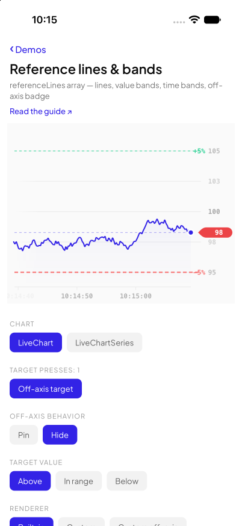
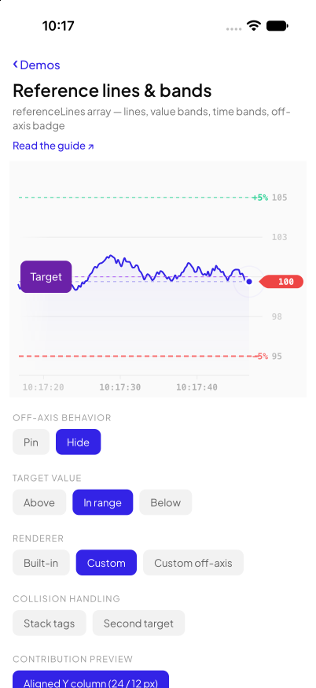
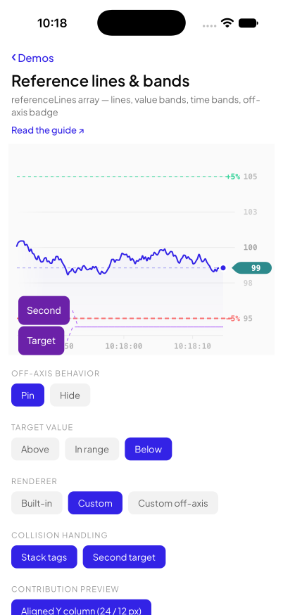
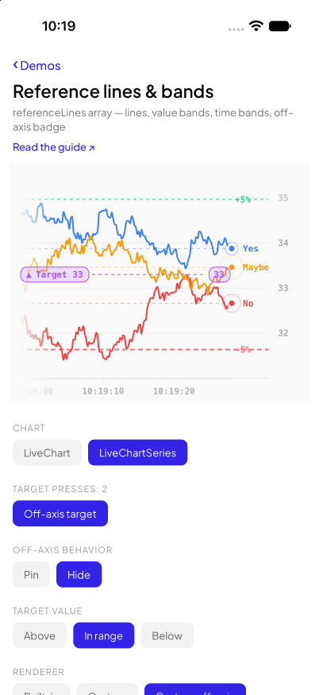

# PR #438 review and native QA

Reviewed on 2026-11-17, starting from `9dc66dfd9e9114366ea5d78977a76112bd0c6ce8`
and integrating current main (`617e561`).

## Findings and changes

- Fixed a merge-blocking behavior gap: `offAxis: "hide"` excluded custom tags
  from stack geometry but did not hide their React Native overlays. Both
  `renderReferenceLine` and `renderOffAxisReferenceLine` now follow the live
  range, and invisible descendants lose touch and accessibility targets.
  Views remain mounted so measurement and in-range recovery still work.
- Added regression coverage that failed on the submitted implementation for
  both custom-renderer modes. It exercises above/in/below/in transitions through
  shared range values without React rerendering, plus default custom pinning.
  Mount-only integration tests explicitly include hidden elements because an
  unmeasured canvas now correctly hides descendants from accessibility queries.
- Resolved the changelog conflict with main. Main also supplies the Expo patch
  versions required by the previously failing dependency-version CI check.
- Updated JSDoc, both component references, the type reference, guide, changelog,
  and the existing reference-lines demo. Clarified range fitting versus hiding,
  custom tags without badges, and the single-series-only interaction/grouping APIs.

Reviewed built-in layout, grouping exclusion, custom measurements, stacking,
press/drag hit geometry, default behavior, and both chart integrations. No
remaining merge-blocking defect found in the reviewed feature.

## Automated validation

- `npm run verify`: typecheck and lint pass; **166 suites / 2,325 tests pass**,
  5 existing tests skipped.
- `npm run build:lib`: declaration build passes.
- `npm run verify:bundle-mode-consumer`: packed consumer iOS Bundle Mode export passes.
- `npx expo install --check`: dependencies up to date.
- React Doctor: **93/100**, no issues, unchanged from the review baseline.
- `git diff --check`: passes.

The Jest run retains existing native Worklets/mock warnings. Its shared-value
regression tests model UI-thread reads; simulator checks below exercise actual
native rendering and interactions.

## Agent-device QA

Used the checkout-assigned **iPhone 17 Pro – LiveChart**, iOS 27.2,
UDID `3D7A9EFD-C00F-4453-98E3-056AF65AF7DB`, with the existing development build
and this checkout's Metro bundle on port 8083. SimSlim profile verification passed.
The simulator and its data were preserved. Session: `pr438`.

In **Reference lines & bands**:

- Built-in name/price pills: pin above and below; hide off-screen; return in range.
- Visible single-series pill taps increment the counter; tapping its old position
  after hiding does not. A visible native custom tag also increments the counter;
  hidden native tags disappear from the accessibility tree and do not increment it.
- Both custom renderer modes: hide/pin above and below, return in range; the
  off-axis-only renderer gives way to the built-in tag in range.
- Both `LiveChart` and `LiveChartSeries`: exercised custom hide/pin/recovery and
  native custom presses. Multi-series correctly has no built-in press/drag API.
- Single-series stack mode: two measured native tags separate at the top and
  bottom, remain within the canvas, and both disappear with hide enabled.
- Legacy `offAxisBadge`: pin/hide below the multi-series plot; the single-series
  in-range price pill still supports dragging.

### Layout tradeoff

The PR deliberately expands stack packing from plot bounds to **canvas bounds**.
Tall or crowded tags can cover time-axis labels in the bottom inset. The guide
now states this explicitly; use collapse mode or more chart height if that area
must stay clear. This is an intended behavior change, not a promise of axis avoidance.

### Evidence and limits

Device QA covers the local **iOS simulator**, not Android or physical devices.
The Mintlify fork preview requires maintainer approval and was not published as
part of this review. CI status is checked separately on the pushed commit.
